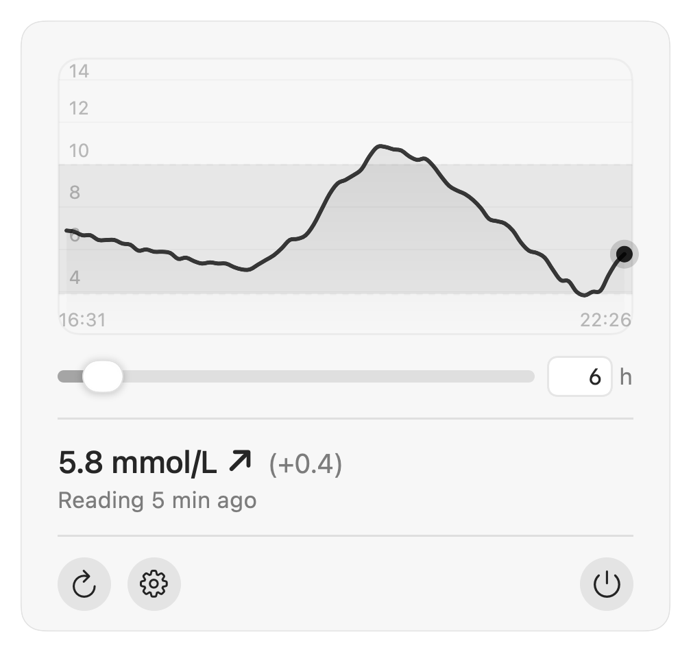

<div align="center">

<picture>
  <source media="(prefers-color-scheme: dark)" srcset="docs/icon-dark.png">
  
</picture>

# Sugarglider

Your Nightscout blood glucose, in the macOS menu bar.

[](https://github.com/nvmddev/sugarglider/actions/workflows/ci.yml)
[](https://github.com/nvmddev/sugarglider/releases/latest)
[](https://github.com/nvmddev/sugarglider/releases)
[](#requirements)
[](LICENSE)

</div>

Your latest reading and its trend arrow sit in the menu bar. Everything else,
like the chart and the last few hours of history, is one click away. No Dock
icon, no window in the way.

<picture>
  <source media="(prefers-color-scheme: dark)" srcset="docs/menubar-dark.png">
  
</picture>

<sub>Actual size. Plain, with the change since the last reading, and flagged
once it goes stale.</sub>

> Not a medical device. It shows what your Nightscout site already has, it can
> show stale or wrong values, and it never alarms. Treatment decisions belong
> with your approved CGM or meter and your care team.

## Install

```sh
brew install --cask nvmddev/tap/sugarglider
```

Or grab the `.dmg` from the [latest release](https://github.com/nvmddev/sugarglider/releases/latest)
and drag **Sugarglider.app** into `/Applications`. Signed and notarized, so it
opens without a Gatekeeper detour.

Want it running after a restart? Turn on **Open at Login** in its settings.

## Set up

The menu bar shows `CGM ⚙` until you point it at a site. Click it, then the
gear button (or press ⌘,), and fill in:

- **Nightscout URL**, e.g. `https://your-site.nightscout.app`
- **Access token**, if your site needs one. Make it in Nightscout under
  *Admin Tools → Subjects* with the `readable` role. Leave it empty for a site
  that allows unauthenticated reads.

There's no Save button. Settings apply as you type, and the tab tells you
straight away whether the connection works.

## What it shows

<picture>
  <source media="(prefers-color-scheme: dark)" srcset="docs/dropdown-dark.png">
  
</picture>

<sub>Made up readings, not anyone's real data.</sub>

- The current value and trend arrow in the menu bar, optionally with the change
  since the last reading. When a reading gets old (11 minutes by default, you
  can change that), it picks up a `⚠` and its age, so a short gap is easy to
  tell from a feed that died.
- A chart of the last 2 to 72 hours, an hour per step on the slider. Hover any
  point for its value and time. Gaps longer than 15 minutes break the line
  instead of pretending there was data.
- When a reading is past what your sensor can measure, you see LOW or HIGH,
  as in Nightscout, and the chart line turns dotted for that stretch.
- Color by zone: very low, below, in range, above, very high. Pick every
  color yourself, or blend them smoothly, or save a look as a preset and
  switch back to it later. The stock palette is monochrome and follows
  light and dark mode. The dropdown itself can be see-through glass or solid.
- mmol/L or mg/dL, switchable any time. Your target range and the very
  low/high bounds are yours to set.
- Pump data, if your site has it: active insulin, reservoir and battery under
  the reading, plus boluses, the delivery rate and pump or sensor alerts on the
  chart, in colors you pick. If your uploader also sends the pump mode or daily
  figures, you get those too. Every item has its own switch in
  **Settings → Pump**, and a site with only CGM data shows none of it.
- No notifications, ever. Sugarglider only sees your Nightscout site, so it
  can't tell a sensor gap from a flat uploader, and it won't pretend otherwise.

Sugarglider misses or misreads something your uploader sends, or you'd like an
option it doesn't have? [Open an issue](https://github.com/nvmddev/sugarglider/issues/new/choose)
or a pull request. For pump values, paste a record from your site's
`/api/v1/devicestatus.json` and take out anything personal, like the device name.

## Trend arrows

| Arrow | Nightscout direction |
|-------|----------------------|
| ↑↑    | DoubleUp             |
| ↑     | SingleUp             |
| ↗     | FortyFiveUp          |
| →     | Flat                 |
| ↘     | FortyFiveDown        |
| ↓     | SingleDown           |
| ↓↓    | DoubleDown           |

## Privacy

Sugarglider talks to your Nightscout site and nothing else. No telemetry, no
analytics, no third-party anything. Your site URL stays in the app's preferences
on your Mac, and the access token goes into your Keychain, where other programs
can't read it. The app runs in macOS's App Sandbox, allowed to make network
requests and nothing more.

It polls your site once a minute by default, which you can change, and only
pulls chart history and pump data when you open the dropdown. After the first
fetch it only asks for what's new.

## Requirements

macOS 26 Tahoe or newer, on a Mac with Apple silicon. Sugarglider is built for
Tahoe's Liquid Glass design, so it won't run on older versions. Intel Macs
aren't supported.

## Build

```sh
git clone https://github.com/nvmddev/sugarglider.git
cd sugarglider
./build.sh
open Sugarglider.app
```

You'll need Xcode 26 or newer. Or skip the script, open `Sugarglider.xcodeproj`
and hit ⌘R. Pure Swift and SwiftUI, zero dependencies, and the binary stays
under a megabyte.

Pull requests welcome. [CONTRIBUTING.md](CONTRIBUTING.md) has the setup, how
the code fits together, and the commit message format. Past releases are in
[CHANGELOG.md](CHANGELOG.md).

## License

[MIT](LICENSE)
