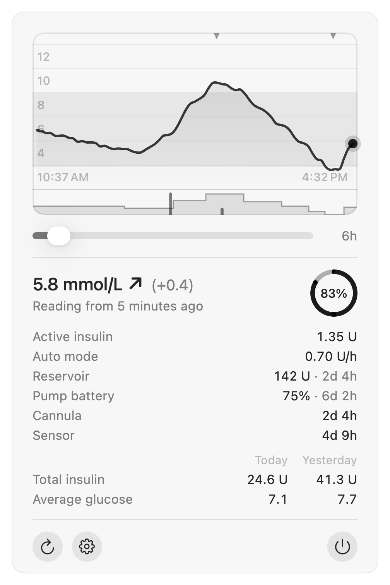
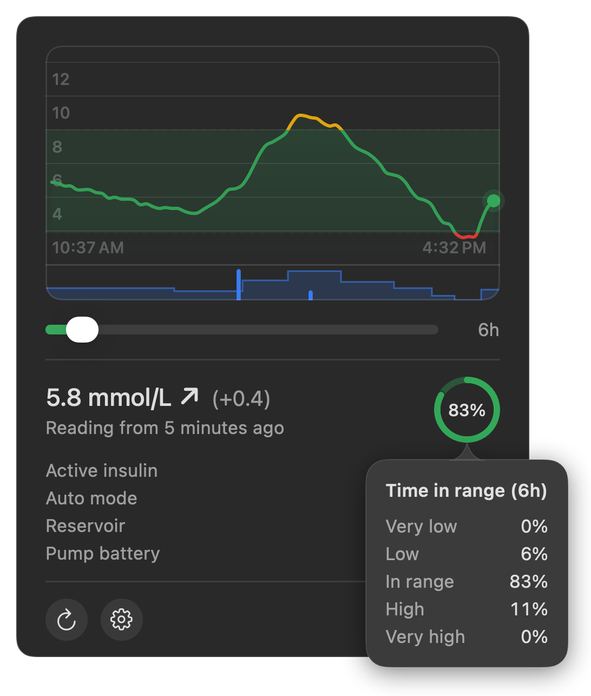

<div align="center">

<picture>
  <source media="(prefers-color-scheme: dark)" srcset="docs/icon-dark.png">
  
</picture>

# Sugarglider

Your Nightscout blood glucose in the macOS menu bar.

[](https://github.com/nvmddev/sugarglider/actions/workflows/ci.yml)
[](https://github.com/nvmddev/sugarglider/releases/latest)
[](https://github.com/nvmddev/sugarglider/releases)
[](#install)
[](LICENSE)

</div>

Sugarglider shows your latest glucose reading and its trend arrow in the menu
bar. Click it to see a chart and your time in range. If your Nightscout site
has pump data, you see that too.

<picture>
  <source media="(prefers-color-scheme: dark)" srcset="docs/menubar-dark.png">
  
</picture>

<sub>Actual size. A reading, the same with the change since the last one, and
an old reading with its age.</sub>

> [!WARNING]
> Sugarglider is not a medical device. It only shows what your Nightscout site
> reports. That data can be old or wrong. The app has no alarms. Don't use it
> to make treatment decisions.

## Features

<picture>
  <source media="(prefers-color-scheme: dark)" srcset="docs/dropdown-dark.png">
  
</picture>
<!-- The second picture shows the other appearance, so every reader sees both. -->
<picture>
  <source media="(prefers-color-scheme: dark)" srcset="docs/dropdown-colors-light.png">
  
</picture>

<sub>The default look with all pump data turned on, and custom colors with the
time in range details open. One is in light mode, the other in dark mode. All
data is made up.</sub>

- Your latest reading and trend arrow in the menu bar. You can add the change
  since the last reading.
- When readings stop coming in, the menu bar shows ⚠ and how old the last one
  is.
- A chart of the last 2 to 72 hours. Hover over a reading to see its value and
  time.
- Your time in range for the hours the chart shows. Click the ring for details.
- mmol/L or mg/dL, with your own target range.
- Your own colors for each zone, from very low to very high. You can save them
  as presets.
- Light and dark mode, following your Mac.
- Pump data, if your site has it: active insulin, reservoir, battery, boluses
  and more. Pick what you want to see in **Settings → Pump**.
- How long ago you changed the reservoir, pump battery, cannula or sensor.
- English and German. [More languages](#languages) are welcome.

## Install

Sugarglider needs macOS 26 Tahoe or later on a Mac with Apple silicon.

```sh
brew install --cask nvmddev/tap/sugarglider
```

Or download the `.dmg` from the
[latest release](https://github.com/nvmddev/sugarglider/releases/latest) and
drag Sugarglider into your Applications folder. The app is notarized by Apple.

To update, run `brew upgrade` or download the new release. The
[changelog](CHANGELOG.md) lists what's new.

## Setup

1. Click `CGM ⚙` in the menu bar, then the gear button.
2. Enter your **Nightscout URL**, for example `https://your-site.nightscout.app`.
3. If your site needs a token, enter it in the **Access token** field. You can
   create one in Nightscout under **Admin Tools → Subjects**. The `readable`
   role is enough.

There is no Save button. Changes apply right away, and the window shows whether
the connection works.

To start Sugarglider when you log in, turn on **Open at Login** in the settings.

## Languages

Sugarglider comes in English and German. It follows the language of your Mac.
To use a different language for Sugarglider only, go to **System Settings →
General → Language & Region → Applications**.

More languages are welcome. [Open an issue](https://github.com/nvmddev/sugarglider/issues/new/choose)
to ask for one, or add it yourself in a pull request.
[CONTRIBUTING.md](CONTRIBUTING.md#adding-a-language) explains how.

## Privacy

Sugarglider only connects to your Nightscout site. It has no analytics or
tracking. Your access token is stored in the macOS Keychain. The app runs in
the App Sandbox.

By default it checks for a new reading once a minute. The chart history and
pump data load when you open the dropdown.

## Feedback

For bugs and ideas, [open an issue](https://github.com/nvmddev/sugarglider/issues/new/choose).
If a pump value is missing or wrong, include a record from your site's
`/api/v1/devicestatus.json`. Remove names, serial numbers and other personal
details first.

## Build from source

You need Xcode 26 or later.

```sh
git clone https://github.com/nvmddev/sugarglider.git
cd sugarglider
./build.sh
open Sugarglider.app
```

Or open `Sugarglider.xcodeproj` and press ⌘R. The app is written in Swift and
SwiftUI and has no third-party dependencies.

Pull requests are welcome. [CONTRIBUTING.md](CONTRIBUTING.md) explains how the
code fits together and how to write commit messages.

## License

[MIT](LICENSE)
